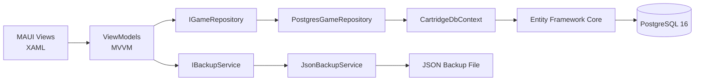

# CartridgeApp

Кросплатформений трекер ігрового беклогу на **.NET MAUI** для курсової роботи.

## Технології

- .NET 10 MAUI
- MVVM
- Entity Framework Core 10
- Npgsql / PostgreSQL 16
- Docker Compose
- Shell Navigation та TabBar
- System.Text.Json
- xUnit, EF Core InMemory

## Основний функціонал

- пошук, сортування та фільтрація ігор;
- додавання, редагування, видалення та швидка зміна статусу;
- сторінка гри з рейтингом, годинами й нотатками;
- статистика беклогу та розбивка по платформах;
- рулетка зі стандартним і favorites-only режимом;
- JSON експорт і імпорт із перевіркою дублікатів;
- світла й темна теми;
- PostgreSQL-контекст EF Core із seed-даними.

## Запуск PostgreSQL

```powershell
docker compose up -d postgres
```

Параметри БД відповідають `docker-compose.yml`:

- host: `localhost` або `10.0.2.2` для Android емулятора
- port: `5432`
- database: `cartridge`
- user: `cartridge`
- password: `cartridge`

## Запуск застосунку

```powershell
dotnet restore CartridgeApp/CartridgeApp.csproj
dotnet build CartridgeApp/CartridgeApp.csproj -f net10.0-windows10.0.19041.0
dotnet run --project CartridgeApp/CartridgeApp.csproj -f net10.0-windows10.0.19041.0
```

## Тестування

```powershell
dotnet restore CartridgeApp.Tests/CartridgeApp.Tests.csproj
dotnet test CartridgeApp.Tests/CartridgeApp.Tests.csproj
```

## Архітектура



Ті самі ViewModel-інтерфейси використовуються для UI і unit-тестів. PostgreSQL хост вибирається відповідно до платформи: localhost для Windows, iOS, macOS; `10.0.2.2` для Android emulator.
